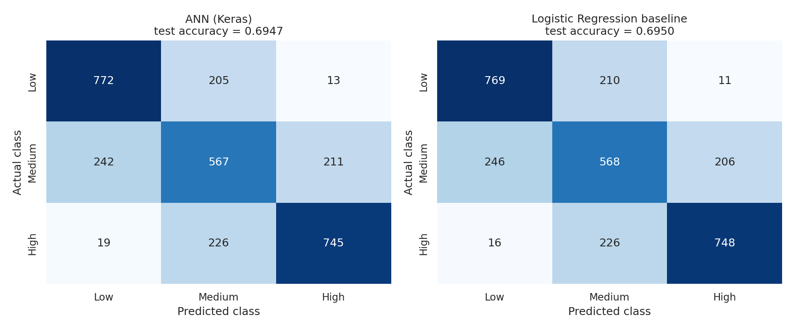

# Evaluation Report — AI-Based Student Performance Risk Predictor

_Generated automatically by `notebooks/ann_training.ipynb` from the actual run on 2026-10-17 17:35:01 UTC (seed 42).
Re-running the notebook regenerates every number below. Small differences can appear on a different machine or library version._

## 1. Dataset overview
* File: `data/student_data.csv` — **15,000 rows**, 12 columns, supplied with the assignment and not modified.
* Target: `performance_category` — Low: 4,950, Medium: 5,100, High: 4,950.
* 10 input features: `age`, `attendance_pct`, `study_hours_per_week`, `previous_score`, `assignment_completion_pct`, `internal_assessment_score`, `participation_score`, `sleep_hours_per_day`, `extracurricular_hours_per_week`, `failed_subjects`.
* `student_id` is an identifier (unique per row) and is **not** used as a feature.
* Data quality checks: 0 missing values, 0 duplicate rows, all values within valid ranges (see notebook section 4).
* Leakage check (training rows only): best single feature alone reaches 0.564 5-fold accuracy (`study_hours_per_week`); the student-id number alone reaches 0.334 (chance ≈ 0.340).

## 2. Preprocessing steps
1. Features and target separated; label mapping fixed as Low=0, Medium=1, High=2.
2. Stratified split with seed 42: train 10,200 / validation 1,800 / test 3,000 rows. The test set was used only for the final evaluation.
3. `StandardScaler` fitted on the training rows only, then applied unchanged to validation, test and (via `models/scaler.joblib`) to every inference request.

## 3. Baseline models
* **Majority-class dummy** (always predicts the most common class) — the no-skill floor.
* **Logistic Regression** (`StandardScaler` → `LogisticRegression`, `max_iter=1000`), trained on the same 10,200 training rows as the ANN.

## 4. ANN architecture
Feed-forward network: Input(10) → Dense(16, ReLU) → Dense(3, Softmax); 227 trainable parameters.

Architecture choice (validation set only; rule: lowest validation loss, preferring a simpler model if within 1 %):

| candidate | parameters | epochs_run | best_epoch | val_loss | val_accuracy |
|---|---|---|---|---|---|
| A: 16 | 227 | 91 | 81 | 0.6403 | 0.6933 |
| B: 32-16 | 931 | 24 | 14 | 0.6492 | 0.6894 |
| C: 64-32 | 2883 | 17 | 7 | 0.6529 | 0.6894 |
| D: 64-32-16 | 3363 | 14 | 4 | 0.6506 | 0.6889 |

Chosen: **A: 16**.

## 5. Training configuration
Loss `sparse_categorical_crossentropy`; optimizer Adam (learning rate 0.001); batch size 64; up to 100 epochs; early stopping on validation loss (patience 10, restore best weights); model checkpoint on best validation loss.
Training ran 91 epochs; best epoch 81. Learning curves: `reports/training_curves.png`.

## 6. Evaluation methodology
Both models were evaluated once on the same untouched test set (3,000 students). Metrics: accuracy; macro-averaged precision, recall, F1 (the three classes weighted equally); class-wise precision/recall/F1; confusion matrix. The ± column is an approximate 95 % margin of error for accuracy due to test-set size only.

## 7. Actual evaluation metrics (test set)
| model | accuracy | macro_precision | macro_recall | macro_f1 | accuracy ± (95%) |
|---|---|---|---|---|---|
| Majority-class dummy | 0.3400 | 0.1133 | 0.3333 | 0.1692 | ±0.0170 |
| Logistic Regression | 0.6950 | 0.6956 | 0.6964 | 0.6958 | ±0.0165 |
| ANN (Keras) | 0.6947 | 0.6948 | 0.6961 | 0.6953 | ±0.0165 |

ANN accuracy by split — train 0.6919, validation 0.6933, test 0.6947.

### Class-wise metrics
| class | support | LogReg precision | LogReg recall | LogReg f1 | ANN precision | ANN recall | ANN f1 |
|---|---|---|---|---|---|---|---|
| Low | 990 | 0.7459 | 0.7768 | 0.7610 | 0.7473 | 0.7798 | 0.7632 |
| Medium | 1020 | 0.5657 | 0.5569 | 0.5613 | 0.5681 | 0.5559 | 0.5619 |
| High | 990 | 0.7751 | 0.7556 | 0.7652 | 0.7688 | 0.7525 | 0.7606 |

### ANN classification report
```
              precision    recall  f1-score   support

         Low     0.7473    0.7798    0.7632       990
      Medium     0.5681    0.5559    0.5619      1020
        High     0.7688    0.7525    0.7606       990

    accuracy                         0.6947      3000
   macro avg     0.6948    0.6961    0.6953      3000
weighted avg     0.6935    0.6947    0.6939      3000
```

### Logistic Regression classification report
```
              precision    recall  f1-score   support

         Low     0.7459    0.7768    0.7610       990
      Medium     0.5657    0.5569    0.5613      1020
        High     0.7751    0.7556    0.7652       990

    accuracy                         0.6950      3000
   macro avg     0.6956    0.6964    0.6958      3000
weighted avg     0.6943    0.6950    0.6945      3000
```

## 8. Confusion matrices (rows = actual, columns = predicted)


ANN:

|  | pred Low | pred Medium | pred High |
|---|---|---|---|
| actual Low | 772 | 205 | 13 |
| actual Medium | 242 | 567 | 211 |
| actual High | 19 | 226 | 745 |

Logistic Regression:

|  | pred Low | pred Medium | pred High |
|---|---|---|---|
| actual Low | 769 | 210 | 11 |
| actual Medium | 246 | 568 | 206 |
| actual High | 16 | 226 | 748 |

## 9. Baseline versus ANN
**Which model is better?** On the same 3000 test students the ANN (macro-F1 0.6953, accuracy 0.6947) and Logistic Regression (macro-F1 0.6958, accuracy 0.6950) are practically tied: the macro-F1 difference is -0.06 percentage points, which is smaller than the roughly ±1.6 point sampling uncertainty of this test set. These results do not show that the ANN is better than the simple baseline.

**Versus no skill:** always predicting the most common class gives accuracy 0.3400; both trained models are clearly above that floor (0.6950 and 0.6947).

## 10. Observations
* **Class differences (ANN):** best class is Low (F1 0.763), weakest is Medium (F1 0.562); gap 0.201.
* **Class differences (Logistic Regression):** best class is High (F1 0.765), weakest is Medium (F1 0.561); gap 0.204.
* **Most common ANN confusion:** 242 students whose true class was Medium were predicted as Low.
* **Overfitting / underfitting:** training accuracy (0.6919), validation accuracy (0.6933) and test accuracy (0.6947) are close to each other, so there is no strong sign of overfitting. Early stopping picked epoch 81 of 91 run. Accuracy is modest in absolute terms. Making the network larger did not lower validation loss in the architecture comparison, and the simple linear baseline scores about the same, which is consistent with the classes overlapping heavily in these features (or the labels containing noise) rather than the network being too small. This is an interpretation, not something the numbers prove.

## 11. Limitations
**Limitations:** (1) One dataset, one random split and one seed: results could shift slightly with another split. (2) The data is unusually clean (no missing values, no duplicates, near-perfectly balanced classes), which is uncommon in real school records, so the results may not transfer to real students. (3) We do not know how `performance_category` was defined; the model learns the dataset's labelling, not true ability. (4) Features are correlated with the category but this does not prove cause and effect. (5) The tool must not be used for real decisions about students; it is for learning. (6) Probabilities from a softmax output are model scores, not guaranteed real-world certainty.

## 12. Conclusion
The conclusions are limited to what was measured: the ANN and the Logistic Regression baseline performed about equally on this dataset's test split (macro-F1 0.6953 for the ANN vs 0.6958 for Logistic Regression). The ANN is a working, saved, reloadable model that serves predictions through the Streamlit app and the FastAPI endpoint, but it is an educational model whose outputs are estimates, not guarantees about any student.
